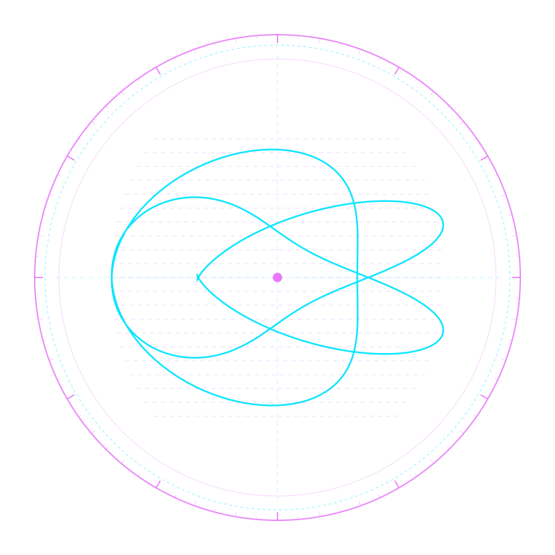

# 🌌 Phantasma (`phantasma-dist`) — Official Distribution & Verification Hub

> **Zero-GPU Pure-Terminal 3D SDF Raymarcher, Parallax Hologram & God Odyssey in Pure Rust**  
> *Zero GPU dependencies • Pure safe Rust • Musl static standalone binary • 100% Adversarial TDD Tested*

[](https://github.com/rmediatech/phantasma-dist/releases/tag/v0.1.0)
[](https://rmediatech.com/downloads)
[-brightgreen.svg)](#)
[-blue.svg)](#)
[](#)
[-blueviolet.svg)](SOVEREIGN_RELEASE_KEY.asc)
[](https://rmediatech.com)
[](LICENSE)

<p align="center">
  
</p>

---

## 🏛️ Overview

**Phantasma** is a pure-Rust, zero-GPU demoscene raymarching engine that renders real-time, mathematically continuous 3D geometry, fractals, PBR studio lighting, and soft shadows directly inside standard terminal emulators.

Operating without GPU drivers, OpenGL, Vulkan, or X11/Wayland windows, Phantasma projects continuous 3D forms at **over 220 FPS** on pure CPU hardware.

### Core Capabilities
* **Zero-GPU Terminal Raymarching**: Renders signed distance field (SDF) continuous geometry using Rayon CPU multi-threading directly into standard ANSI TrueColor half-blocks (`▀`).
* **4-Tap Tetrahedral Surface Normals**: Evaluates smooth continuous normals ($\nabla \text{SDF}(p)$) without polygonal meshes.
* **Physically Based Rendering (PBR)**: Microfacet specular highlights, ambient occlusion, and cone-traced soft shadows.
* **Lightweight Head-Tracking**: Parallax perspective shifts derived from temporal motion differencing.
* **Single Standalone Static Binary**: Statically linked against Musl libc, self-contained, with $<15\text{MB}$ memory footprint.

---

## 📦 Binary Verification & Download

Verified standalone binaries are distributed directly through the **[RMediaTech Sovereign Binary Vault](https://rmediatech.com/downloads)**:

| Platform | Architecture | Checksum (SHA-256) | Vault Download |
| :--- | :--- | :--- | :--- |
| **Linux (Static Musl)** | `x86_64` | `4a4e53a9bb8a716e1efccc3ffbe267c49e04fcf348bd0c1600adf54a8b36b04e` | [Download (2.8 MB)](https://rmediatech.com/bin/phantasma) |

### 1-Click Stream Download & Installation
```bash
# 1-Click Stream Install
curl -sSL https://rmediatech.com/install/phantasma | sh

# Or Direct Binary Download
curl -sSL https://rmediatech.com/bin/phantasma -o phantasma
chmod +x phantasma
```

### Cryptographic Provenance Verification (`SOVEREIGN-SIGN-01`)
All releases are cryptographically sealed by `Rick Walker (Sovereign Release Signing Key) <rick@rmediatech.com>` (Key ID: `4E428019A109578B`):

```bash
# Import Public Key
curl -sSL https://rmediatech.com/SOVEREIGN_RELEASE_KEY.asc | gpg --import

# Verify Detached OpenPGP Signature
curl -sSL https://rmediatech.com/signatures/phantasma -o phantasma.asc
gpg --verify phantasma.asc phantasma
```

---

## 🚀 Quickstart

```bash
# Render interactive chrome ball odyssey scene
phantasma --scene chrome-ball

# Verify embedded cryptographic canary digest
phantasma --verify

# Render Mandelbulb 3D fractal
phantasma --scene mandelbulb
```

---

## 🛡️ License & Provenance

Dual-licensed under MIT OR Apache-2.0. Cryptographically sealed by Rick Walker (`4E428019A109578B`).
